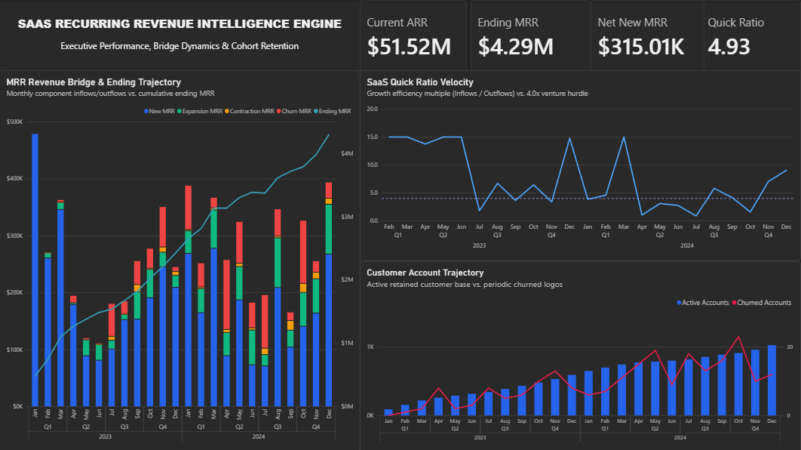
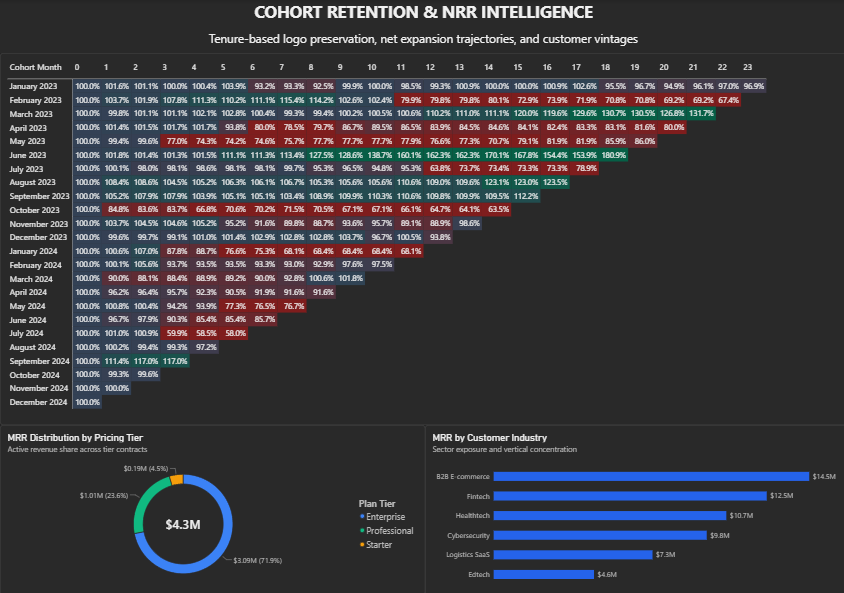

# SaaS Recurring Revenue Intelligence System

An end-to-end analytics, financial engineering, and revenue intelligence platform that processes 14,231 subscription records from a normalized MySQL relational layer into predictive financial models (Excel) and an enterprise-grade executive dashboard suite (Power BI).

---

## Executive BI Dashboards

### Page 1: Executive Overview & Growth Dynamics



* **Top-Line Capital Metrics:** Instant KPI visibility across Current ARR (\$51.52M), Ending MRR (\$4.29M), Period Net New MRR (\$315.01K), and SaaS Quick Ratio (4.93).
* **MRR Revenue Bridge & Ending Trajectory:** Dual-axis decomposition mapping periodic revenue inflows (New, Expansion) against outflows (Contraction, Churn) on the primary axis ($K), anchored by cumulative run-rate ARR trajectory ($M) on the secondary axis.
* **SaaS Quick Ratio Velocity:** Longitudinal efficiency tracking measuring gross inflows against gross outflows, benchmarked directly against the institutional 4.0x venture hurdle.
* **Customer Account Trajectory:** Dual-metric tracking of total active retained accounts contrasted with periodic churned logos.

---

### Page 2: Cohort Retention & NRR Intelligence



* **Triangular Cohort Heatmap:** 24-month vintage decay tracking Net Revenue Retention (NRR %) across monthly customer cohorts from onboarding ($t=0$) through tenure $t=23$. Custom 3-point color scale isolates net expansion (>115%), baseline stability (100%), and contraction (<85%) with unformatted future tenures.
* **MRR Distribution by Pricing Tier:** Active recurring revenue split across Enterprise, Mid-Market/Professional, and Starter tiers, dynamically tied to current ending MRR run-rate.
* **MRR by Customer Industry:** Horizontal sector exposure ranking revenue across B2B E-commerce, Fintech, Healthtech, Cybersecurity, Logistics SaaS, and Edtech, supporting cross-filtering across vintage retention performance.

---

## System Architecture

```text
[ MySQL Relational Layer ]
   ├── saas_subscription_ledger (14,231 records)
   ├── vw_mrr_revenue_bridge (Inflow/outflow aggregations)
   └── vw_cohort_nrr_matrix (Tenure-based logo & NRR retention)
            │
            ├─────────────────────────────────────────┐
            ▼                                         ▼
[ Financial Sensitivity Model ]         [ Power BI Reporting Layer ]
  SaaS_Financial_Sensitivity_Model.xlsx   SaaS_Executive_Revenue_Intelligence.pbix
  ├── 12-Month Rolling ARR Engine         ├── Star Schema Semantic Model
  ├── Dynamic NRR via LET Logic           ├── Centralized _Measures Table
  └── Two-Way What-If Sensitivity         ├── Page 1: Executive Overview
                                          └── Page 2: Cohort Retention & NRR Matrix

```

---

## Core Financial Formulations

### 1. SaaS Quick Ratio

$$\text{Quick Ratio} = \frac{\text{New MRR} + \text{Expansion MRR}}{\text{Contraction MRR} + \text{Churn MRR}}$$


*Evaluates growth efficiency by calculating recurring revenue dollars generated per dollar lost to contraction and churn.*

### 2. Net Revenue Retention (NRR %)

$$\text{NRR}_t = \frac{\text{Retained MRR}_t}{\text{Cohort Baseline MRR}_0} \times 100$$


*Measures cohort expansion or decay over tenure periods $t$, accounting for account upgrades, downgrades, and cancellations.*

### 3. Logo Retention Rate

$$\text{Logo Retention}_t = \frac{\text{Active Accounts}_t}{\text{Cohort Starting Accounts}_0} \times 100$$


*Measures absolute logo survival rate of an acquired vintage over time.*

---

## Repository Structure


saas-recurring-revenue-intelligence/
├── assets/
│   ├── page1_executive_overview.png
│   └── page2_cohort_matrix.png
├── bi/
│   └── SaaS_Executive_Revenue_Intelligence.pbix
├── excel/
│   └── SaaS_Financial_Sensitivity_Model.xlsx
├── sql/
│   ├── 01_schema_definitions.sql
│   ├── 02_vw_mrr_revenue_bridge.sql
│   └── 03_vw_cohort_nrr_matrix.sql
├── .gitignore
└── README.md

```

---

## Technical Stack

* **Database:** MySQL 8.0+ (Normalized subscription ledger, analytical window functions, automated view transformations)
* **Financial Modeling:** Microsoft Excel (Dynamic arrays, LET helper logic, two-way sensitivity data tables)
* **Business Intelligence:** Microsoft Power BI Desktop (DAX measure library, custom 3-point conditional matrix heatmaps, dual-axis line/stacked column visuals)
* **Automation:** Power BI On-Premises Data Gateway (Standard Mode) for scheduled MySQL database synchronization

---
